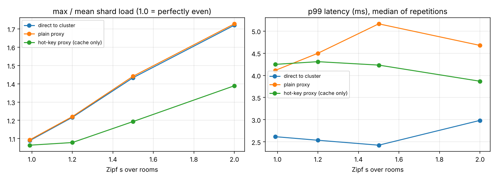

# HotKeyProxy

A Redis Cluster proxy in Go that reproduces the proxy-side hot-key handling ByteDance describes for ABase (SIGMOD '25): detect hot keys with a decaying Space-Saving sketch, serve hot reads from an actively refreshed cache with a staleness bound, optionally combine hot counter writes, route keys to limited proxy groups, and isolate tenants with request-unit quotas and per-shard fair queueing. Measured on a live-room workload (viewer counts, likes, gift leaderboards) with Zipf-skewed rooms, against direct cluster access, a plain proxy and Redis client-side caching.

## Results (measured on one 2-vCPU VM; median of 3 runs)

Full tables: [`results/SUMMARY.md`](results/SUMMARY.md). Design: [`docs/DESIGN.md`](docs/DESIGN.md).

| at Zipf s = 2.0, 10,000 rps open loop | direct to cluster | plain proxy | hot-key proxy |
|---|---|---|---|
| calls on the hottest shard (20 s) | 114,690 | 115,182 | **40,755 (-64%)** |
| max / mean shard load | 1.72 | 1.73 | 1.39 |
| p50 / p99 latency | 0.39 / 3.0 ms | 0.36 / 4.7 ms | 0.35 / 3.9 ms |
| Redis CPU (all shards) | 4.9 s | 6.1 s | 3.5 s |
| proxy requests per CPU-second | | 15,613 | 18,639 (+19%) |
| read hit ratio, lost increments | | | 86%, 0 |

- **Hot-shard load scales down with skew**: the hottest shard's call count falls 33% at s = 1.2 and 64% at s = 2.0, and no counter increment or gift score is lost (checked after every run).
- **Freshness**: served cached replies are at most 50 ms old by construction; 40% are under 10 ms.
- **Detection**: when a cold room becomes the most popular one mid-run, its viewer-count key is cached 173 to 177 ms later (3 runs).
- **Limited fan-out** (4 proxies, 64-entry caches): pinning each key to one proxy group raises the hit ratio from 32% to 47%, at the cost of proxy load imbalance (max/mean 1.21 vs 1.01).
- **Write combining is a trade, not a free win**: a 500 us window cuts calls on the hottest shard by a further 26% but raises p50 for all commands from 0.33 to 1.03 ms, because RESP replies leave in order and reads queue behind combined writes on the same connection. It is off by default.



**Redis client-side caching is the stronger baseline at moderate skew.** Four simulated application servers with `CLIENT TRACKING` (local caches invalidated by Redis), same workload:

| | hottest shard calls, s = 1.2 | s = 2.0 | read hit ratio (1.2 / 2.0) | invalidations (1.2 / 2.0) |
|---|---|---|---|---|
| direct to cluster | 81,104 | 114,690 | | |
| CLIENT TRACKING, 4 app servers | **40,478** | 43,703 | 69% / 77% | 28,127 / 31,426 |
| hot-key proxy | 54,381 | **40,755** | 42% / 86% | |

At s = 1.2 tracking leaves the hottest shard 26% fewer calls than the proxy does, because it caches every key each server reads while the proxy caches only keys its sketch calls hot. At s = 2.0 the proxy's single shared copy wins (7% fewer hottest-shard calls), since every application server fetches and invalidates its own copy of each hot key. Tracking also has to be built into every client; the proxy is one deployment.

**Throughput per proxy core** (proxy on one vCPU with `GOMAXPROCS=1`; Redis and the load generator on the other; skew 1.2): a plain proxy core saturates near 39-41k req/s and the hot-key proxy near 43-44k req/s (cache hits skip the shard round trip). At 40,000 req/s offered, the plain proxy's p99 is 874 ms (it is already queueing) and the hot-key proxy's 99.5 ms; both process about 48k requests per proxy CPU-second there.

**Tenant isolation** (E5; victim: the live-room mix at 2,000 req/s; noisy tenant: top-200 leaderboard reads at 300 req/s on a 600 RU/s quota, bursting 10x for 10 s; caching off; 3 repetitions):

| isolation | victim p99 in the burst | victim p99 outside it | noisy tenant achieved | noisy tenant p99 |
|---|---|---|---|---|
| off | 4.6 ms | 1.5 ms | 1,200 req/s | 5.3 ms |
| RU-weighted fair queueing, soft quota | 3.9 ms | 1.4 ms | 1,200 req/s | 4.5 ms |
| **fair queueing + enforced quota** | **1.8 ms** | 1.4 ms | 303 req/s | 89 s |

Only an enforced quota protected the victim. With a soft quota (ABase-style: over-quota requests are deprioritised, not stopped) the noisy tenant still got all 1,200 req/s through, and per-shard fair queueing almost never engaged (60 requests queued): the interference is CPU and I/O shared on the box, not queueing at a shard, and reordering cannot fix that. Enforcing the quota held the noisy tenant to its 600 RU/s (303 req/s) and the victim's burst p99 to near its baseline (1.6-1.8 ms in every repetition, against 3.5-5.1 ms for the other two). The cost moved to the noisy tenant, and exposed a design gap: its open-loop client kept sending 3,000 req/s, each connection waited for tokens one request at a time so the 200 ms refusal limit never triggered (0 refused), and the backlog queued on its connections until p99 reached 89 s. Refusal has to be based on how long a request has been queued on the connection, not on the token debt at the moment it is read. This run is on a fresh instance of the same VM type, all three arms together; absolute latencies there are lower than in the other experiments.

## Two mistakes the benchmarks caught

- **Write combining on by default.** The first full run had a 2 ms combining window on by default, and the hot-key proxy looked *slower* than the plain proxy: p50 rose with skew to 2.7 ms. A combined write holds its connection's reply queue for the window, and every pipelined read behind it waits (head-of-line blocking). Caching and combining are now separate (combining opt-in, measured on its own); the original runs are not used. `docs/DESIGN.md` section 5.
- **Fair queueing that did not isolate.** The first isolation build only deprioritised over-quota requests (ABase-style soft quota with weighted fair queueing per shard). It changed nothing for the victim, because the interference was not queueing at a shard. Enforced quotas were added, and E5 compares all three arms. The enforced arm then showed a second problem (refusal never triggered, so the throttled tenant's backlog grew without bound); that one is documented, not fixed.

## What is here

```
resp/      RESP2 parser and writer (allocation-free command reads, fuzz test)
cluster/   CRC16 slots, hash tags, slot map from CLUSTER SLOTS (checked against real Redis)
backend/   pipelined connections to each shard, FIFO reply matching
sketch/    sharded Space-Saving with exponential decay (property tests vs exact counts)
proxy/     request path, active-update cache with leases, write combiner, tenants (RU, quotas, per-shard WFQ), /stats
cmd/hkproxy  the proxy
cmd/hkload   open-loop load generator: live-room and leaderboard mixes, direct / proxy / CLIENT TRACKING modes,
             limited fan-out groups, tenants and bursts, lost-write check
bench/     cluster.sh (3-shard Redis Cluster), run_all.sh, plot.py
```

## Reproduce

```
# needs redis-server 7 and redis-cli
bench/run_all.sh          # about 30 minutes: writes results/runs.jsonl, SUMMARY.md, the figure
bench/run_all.sh e5       # tenant isolation only
go test -race ./...
```

## Honest scope

- One 2-vCPU VM runs 3 Redis shards, the proxies and the load generator, so absolute latency and throughput are box-limited and noisy (p99 ranges are in the tables; one 117 ms p99 outlier run was outvoted by a third repetition). Shard-load ratios, hit ratios and lost-write counts do not depend on that. E5 was re-run on a fresh instance of the same VM type after the other experiments; its three arms ran together.
- Reproduces ABase's proxy mechanisms (hot-key detection, active-update cache, limited fan-out, request units with fair queueing) from the paper's description, not its code, and in simplified form: one proxy, RU costs estimated from moving averages, no quota coordination across proxies.
- RESP2 only; `MULTI/EXEC`, blocking commands and pub/sub are refused. No Envoy Redis proxy baseline. The CLIENT TRACKING application servers are simulated inside the load generator.

## Resume bullets (numbers from `results/`)

- Built HotKeyProxy, a Go Redis Cluster proxy reproducing ByteDance ABase's hot-key handling: decaying Space-Saving detection, an actively refreshed read cache with a 50 ms staleness bound and fill leases, opt-in write combining, limited fan-out proxy groups, and request-unit tenant quotas with per-shard fair queueing.
- On a Zipf-skewed live-room workload it cut calls on the hottest shard by 64% (max/mean shard load 1.72 to 1.39) with no lost increments, detected a newly viral room in about 175 ms, and held p99 at 99.5 ms at 40k req/s on one proxy core where a plain proxy reached 874 ms.
- Benchmarked against Redis client-side caching (CLIENT TRACKING): tracking left the hottest shard 26% fewer calls than the proxy at moderate skew (s = 1.2), the proxy 7% fewer than tracking at s = 2.0; and measured that write combining trades latency for shard load through head-of-line blocking (500 us window: 26% fewer hot-shard calls, p50 0.33 to 1.03 ms), so it ships off by default.
- Added request-unit tenant quotas with per-shard weighted fair queueing and found that fair queueing with soft quotas did not isolate (victim burst p99 3.9 vs 4.6 ms with none) while enforced quotas did (1.8 ms, against 1.4 ms without the burst), and that the enforced version needs queue-age-based refusal: without it the throttled tenant's backlog reached an 89 s p99.

## Interview defence

See `docs/DESIGN.md` section 12: why a hot key stays a single-shard problem with Redis I/O threads, Count-Min vs Space-Saving, what breaks with write combining, coordinated omission, and why fair queueing alone did not isolate tenants here.
